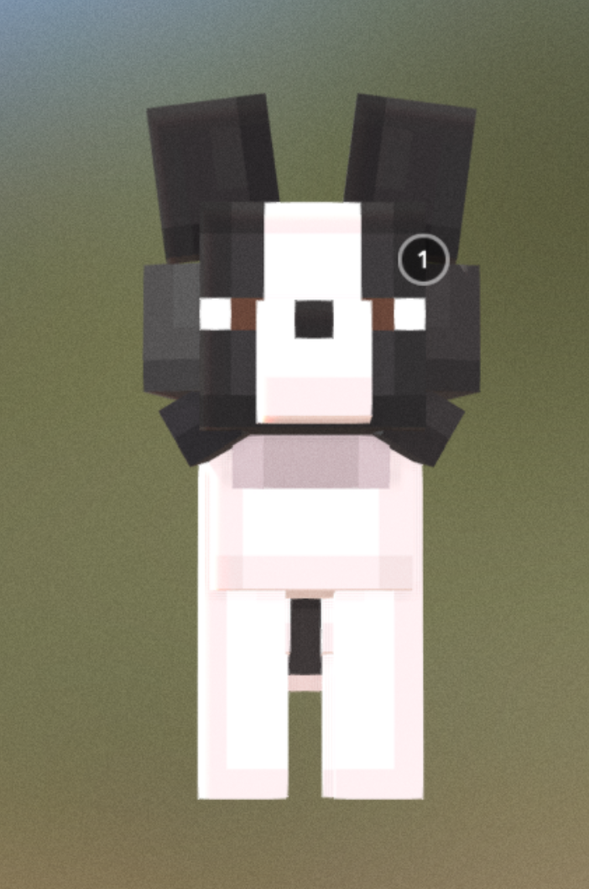
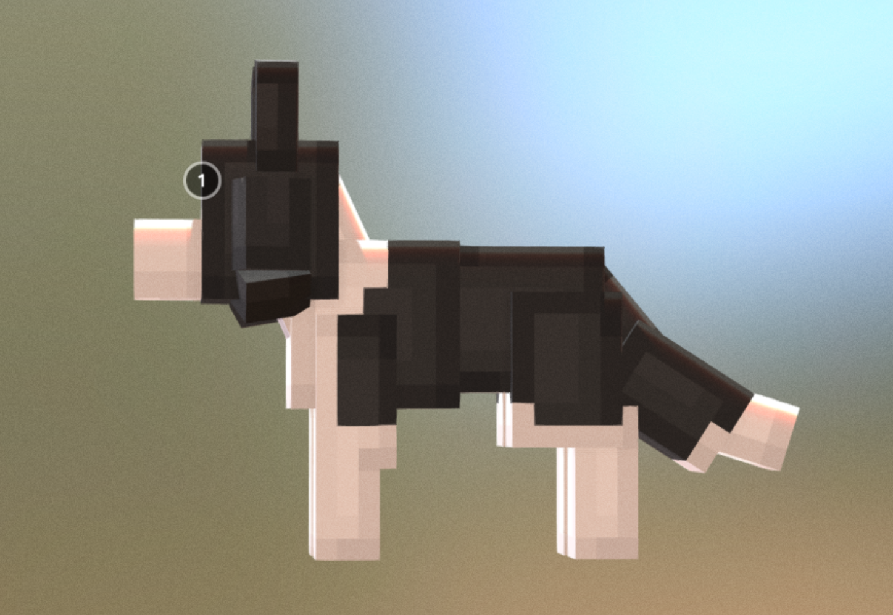
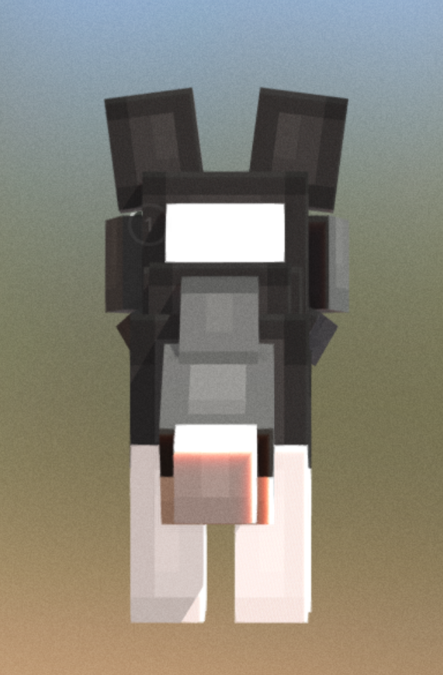
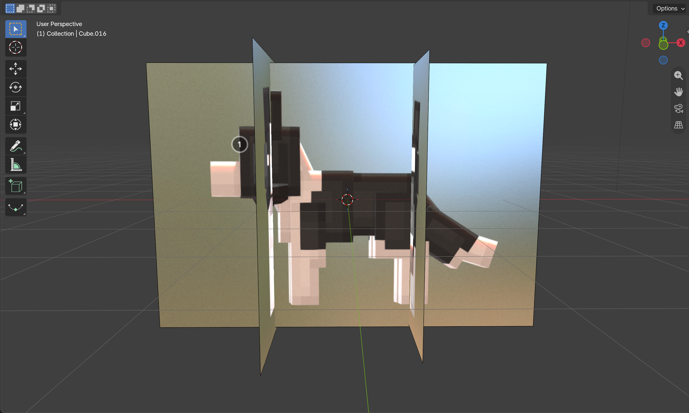
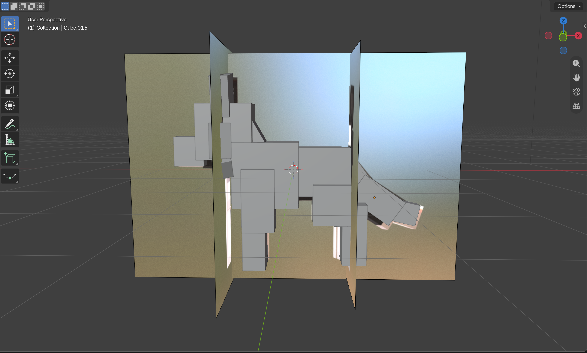

# Dog 3D Model

## Overview

This page details the creation process of a 3D border collie model.

## Modeling Process

### 1. Gathering Reference Images

I began by taking screenshots of the original Minecraft dog model from multiple perspectives, including the front, back, and side views. These screenshots served as reference images to help maintain consistent proportions and capture the overall shape of the dog.

### 2. Importing References into Blender

Next, I imported the screenshots into Blender as reference images, positioning them to correspond with their respective viewing angles.

### 3. Creating the 3D Model

Using the imported images as guides, I recreated the dog model in Blender. The reference images helped determine the relative sizes, proportions, and placement of different body parts.

## References

**Original Model:** [Border Collie Custom Minecraft Model](https://sketchfab.com/3d-models/border-collie-custom-minecraft-model-63dbac7b0f844351b4b7ad84957d184f)

**Original Creator:** jessdragon12 (Sketchfab)

**Modeling Software:** Blender

This model was recreated using the original artwork as a visual reference. Credit for the original design belongs to jessdragon12.
